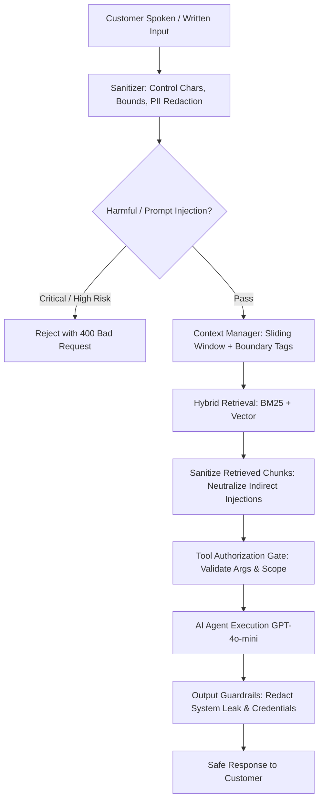

# Aivon Security Policy & Architecture

This document specifies the security architecture, threat model, defensive controls, and operational procedures implemented across the Aivon AI Customer Support platform.

---

## 1. Security Architecture & Threat Model

Aivon is a multi-tenant platform composed of:
1. **Operator Dashboard (`apps/web`)**: Next.js 15, authenticated via Clerk JWT with strict organizational scoping.
2. **Customer Chat Widget (`apps/widget`)**: Next.js 15, session-based customer interaction embedded via iframe.
3. **Embeddable Script (`apps/embed`)**: Zero-dependency lightweight IIFE injecting isolated iframe.
4. **Backend Engine (`packages/backend`)**: Serverless Convex cloud runtime, ACID database, file storage, and integrated AI pipeline.

### Trust Boundaries & Auth Model

| Surface | Auth Model | Scope | Transport |
|---|---|---|---|
| **Operator Dashboard (`private/`)** | Clerk JWT session | `identity.orgId` enforced per function | HTTPS / WSS |
| **Customer Widget (`public/`)** | Ephemeral DB Contact Session (24h) | Bound to `organizationId` + `contactSessionId` | HTTPS / WSS |
| **System Operations (`system/`)** | Internal only | Invokable only by scheduler or server actions | Internal runtime |
| **External Webhooks** | Svix cryptographic signature / shared secret | Verified with timing-safe comparisons | HTTPS POST |

---

## 2. Multi-Tenant & Database Isolation

Convex enforces isolation at the application layer through consistent, audited access patterns:

1. **Dashboard Isolation (`private/` functions)**:
   - Every private query, mutation, and action retrieves `identity = await ctx.auth.getUserIdentity()`.
   - Rejects unauthenticated requests (`code: "UNAUTHORIZED"`).
   - Validates `identity.orgId` on all record lookups (`conversation.organizationId === orgId`).
   - All database updates enforce org-matching indices (`by_organization_id`, `by_org_and_status`).

2. **Customer Widget Isolation (`public/` functions)**:
   - Contact sessions are validated for expiration (`expiresAt < Date.now()`).
   - Every customer operation validates `conversation.contactSessionId === contactSession._id` and `conversation.organizationId === contactSession.organizationId`.
   - Prevents BOLA/IDOR by disallowing clients from supplying arbitrary conversation IDs without a matching session token.

3. **Knowledge Base & RAG Isolation**:
   - Vector embeddings are indexed in `@convex-dev/rag` with explicit `namespace: orgId`.
   - BM25 inverted lexical indices are built strictly per-tenant from `internal.system.ai.rag.corpus.getTenantCorpus`.
   - `MultiTenantRetrievalCache` prefixes all in-memory cache keys with `orgId:`.
   - Guaranteed 0% cross-tenant data leakage across vector, BM25, and semantic cache lookups.

4. **Secret Storage Isolation**:
   - AWS Secrets Manager keys adhere strictly to `tenant/{organizationId}/{service}` hierarchy.
   - Public APIs never return private API keys or server tokens.

---

## 3. API, Webhook, and File-Upload Security

### Webhook Verification
- **Clerk Webhooks (`/clerk-webhook`)**: Verified via Svix cryptographic signatures (`svix-id`, `svix-timestamp`, `svix-signature`). Payloads exceeding 1 MB are rejected with HTTP 413. Handles subscription lifecycle (`subscription.created`, `subscription.updated`, `subscription.active`, `subscription.pastDue`) and membership synchronizations.
- **Vapi Webhooks (`/vapi-webhook`)**: Protected by `VAPI_WEBHOOK_SECRET` evaluated via `timingSafeEqualString` to resist timing attacks. Voice search and transcription endpoints verify tenant organization and convex conversation ownership.

### Knowledge Base File Upload Security
- **MIME & Magic Byte Validation**: Client-supplied extensions and MIME types are untrusted. File signatures (`Uint8Array` magic bytes) are validated for PDF (`%PDF-`), PNG, JPEG, and WebP.
- **Embedded Threat Prevention**: PDFs are scanned for active code (`/JavaScript`, `/JS`, `/Launch`, `/EmbeddedFile`, `/RichMedia`) and rejected before ingestion.
- **Size & Page Limits**: 10 MB maximum file size; 2 MB limit for text/JSON/CSV; 200 page ceiling for PDFs.
- **Fail-Secure Malware Scanning**: External malware scanner webhook requires HTTPS, valid auth tokens, and strict `clean: true` response.

---

## 4. AI Agent, Prompt Injection & RAG Security

Aivon deploys a multi-stage defense-in-depth pipeline (`ModerationPipeline`):



### Prompt Injection & Jailbreak Defense
- Direct injection heuristics block jailbreaks, system prompt overrides, and developer mode attempts.
- Indirect prompt injection protection scans external knowledge documents for malicious injection tags (e.g. `[System Message: ...]`, `<!-- ai-instruction -->`), neutralizing instructions with `[MALICIOUS_INSTRUCTION_REDACTED]`.
- User input is isolated using XML boundary tags (`<untrusted_user_input>`) to prevent delimiter spoofing.

### Tool Execution & Privilege Control
- AI tools (`search`, `escalateConversation`, `resolveConversation`) validate calling context through `ctx.threadId`.
- Conversation ownership is verified against tenant database before executing tool logic.
- Arguments are validated with Zod schemas and character limits (e.g., search queries bounded to 500 characters).

### Output Guardrails & Credential Leak Prevention
- Model outputs are inspected for system instruction disclosures and API key patterns (`sk-proj-`, AWS keys).
- Offending outputs are blocked and replaced with neutral support messaging.

---

## 5. Rate Limiting, Abuse & Cost Control

Aivon deploys a 3-tier distributed rate-limiting and quota architecture:

1. **Client / IP Rate Limiting**:
   - Contact session creation throttled to 5 requests per 60 seconds.
   - Keyed sliding windows for public endpoints (30 requests/min).
2. **Session Message Throttling**:
   - Active chat sessions bounded to 30 messages/minute.
   - Max messages per conversation capped via `widgetSettings` (default 20 messages).
3. **Tenant Distributed Quota Engine (`tenantRateLimits`)**:
   - Plan-based monthly token quotas: Free (50k), Pro (2M), Enterprise (50M).
   - Admission control reserves estimated tokens prior to LLM execution and reconciles actual token usage post-turn.
   - Throttles burst concurrency and blocks execution when monthly quotas are exhausted (`QUOTA_EXHAUSTED`).

---

## 6. Infrastructure, Secrets & Deployment

### Secret Management
- Zero plaintext API keys in client-accessible tables.
- BYOK (Bring Your Own Key) third-party integrations (Vapi, ElevenLabs) stored in AWS Secrets Manager with customer tenant path isolation.
- Public Vapi key retrieval (`public/secrets.ts`) validates tenant and returns only client-safe public keys.

### Browser Security Headers & CSP
- **Operator Dashboard (`apps/web`)**: Strict Content Security Policy (`CSP`), `X-Frame-Options: DENY`, `Strict-Transport-Security`, `X-Content-Type-Options: nosniff`, `Referrer-Policy: strict-origin-when-cross-origin`.
- **Chat Widget (`apps/widget`)**: Scoped CSP allowing iframe embed on host pages (`frame-ancestors *;`), restricted camera/mic permissions, and trusted WebSocket connections to Convex and Vapi.
- **Embed Script (`apps/embed`)**: Hardened postMessage handler validating message origin and payload shape, immutable global API via `Object.freeze`, and strict position attribute validation to prevent CSS/DOM injection.

---

## 7. Vulnerability Remediation History

The following vulnerabilities were identified during security audit and remediated:

| Vulnerability | Severity | Affected Area | Resolution | Status |
|---|---|---|---|---|
| **Clerk Webhook Lifecycle Event Gap** | High | `convex/http.ts` | Handled `subscription.created`, `subscription.active`, `subscription.pastDue`, and `subscription.deleted` to ensure subscription sync | Fixed & Verified |
| **Agent Availability Desync in Queue Completion** | High | `convex/private/queue.ts` | `completeQueueEntry` now frees `queueEntry.assignedAgentId` so assigned operators are not locked in `on_call` | Fixed & Verified |
| **BOLA / Ownership Gap in Voice Call Logs** | High | `convex/private/queue.ts` | `getCallLogs` now validates conversation existence and tenant ownership before collecting calls | Fixed & Verified |
| **Typo in Error Code `UNAUTHORZIED`** | High | `convex/private/conversations.ts` | Fixed typo to standard `UNAUTHORIZED` ensuring client and middleware error handling consistency | Fixed & Verified |
| **Missing Plugin Service in Query Validator** | Medium | `convex/private/plugins.ts` | Added `elevenlabs` literal to `getOne` query validator to match schema and mutation capabilities | Fixed & Verified |
| **Embed Script postMessage TypeError & DOM Tamper** | High | `apps/embed/embed.ts` | Added null/type validation for `event.data`, bounded resize height, canonical position parsing, and froze global API | Fixed & Verified |
| **PII in Observability Telemetry** | Medium | `convex/system/ai/observability/logger.ts` | Deep PII sanitization across structured log `details` objects for credit card and SSN redaction | Fixed & Verified |
| **System/Tool Internal Leak in Queue Summary** | Medium | `convex/system/queue.ts` | Filtered out tool and system messages from customer handoff transcript | Fixed & Verified |

---

## 8. Verification & Test Suite

The security controls are validated by automated test suites in `eval/tests/`:
- `securityAndGuardrails.test.ts`: Input sanitization, injection detection, PII masking, output guardrails, and upload validation.
- `securityHardening.test.ts`: Subscription status validation, safe ID checks, log details sanitization, embed postMessage guards, and transcript filtering.
- `redTeamSafety.test.ts`: Adversarial prompt injections, toxic input blocking, indirect document injection neutralization, and tool parameter bounds.
- `hybridRagAndBM25.test.ts`: Cross-tenant RAG isolation (verified 0% cross-tenant data leakage).
- `rateLimiting.test.ts`: Token quota enforcement and burst rate limiters.
- `queueWorkflow.test.ts`: Multi-agent queue atomic assignment and tenant boundary enforcement.

Run automated security validation:
```bash
pnpm test:security
```
Run full test suite:
```bash
pnpm test
```

---

## 9. Reporting Security Vulnerabilities

If you discover a security vulnerability within Aivon, please disclose it responsibly:
- **Email**: security@aivon.ai
- **Encryption**: Include your public GPG key if you require encrypted communication.
- **Response SLA**: Initial triage within 24 hours; remediation updates every 48 hours until resolved.
- Please do not submit public GitHub issues for security vulnerabilities.
